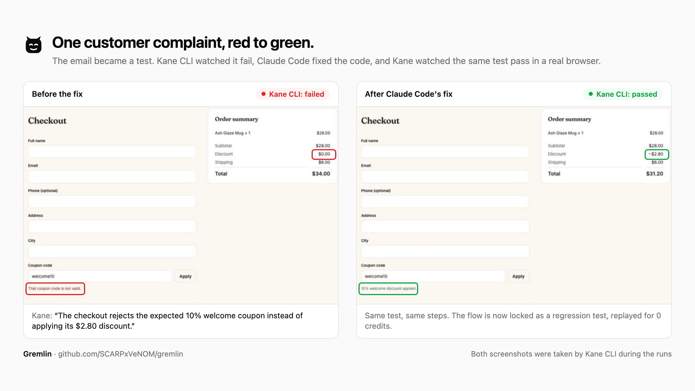

<p align="center">
  
</p>

<h1 align="center">Gremlin</h1>

<p align="center">
  Every bug report becomes a failing test, a fix and a regression test.<br>
  Your own coding agent does the work. <strong>Kane CLI</strong> referees every step in a real browser.
</p>

<p align="center">
  <a href="https://www.npmjs.com/package/gremlin-qa"></a>
  <a href="LICENSE"></a>
  
  <a href="https://github.com/SCARPxVeNOM/kiln-shop/pull/6"></a>
</p>

<p align="center">
  <a href="#see-it-working">See it working</a> ·
  <a href="#for-judges">For judges</a> ·
  <a href="#one-bug-end-to-end">One bug, end to end</a> ·
  <a href="#quickstart">Quickstart</a> ·
  <a href="#try-it-on-kiln">Try it on the demo shop</a> ·
  <a href="#how-the-loop-closes">How the loop closes</a> ·
  <a href="#honest-limits">Honest limits</a>
</p>

<p align="center">
  
</p>

---

A customer writes in: *"I typed welcome10 into the coupon box at checkout but it just says 'That coupon code is not
valid'."* Usually that email becomes a ticket, someone reproduces it by hand, a fix ships, and nothing stops the bug
from coming back.

With Gremlin, **the email becomes the test**. Your coding agent turns it into a plain-English flow, and it only counts
as a bug once Kane CLI has watched that flow fail in a real browser. Your agent then fixes the product (it isn't allowed
to touch the test), Kane re-runs the same flow and its neighbours, and the flow is locked into a regression library
that every later agent "done" and every PR replays.

Gremlin never decides on its own whether something works: **every pass and every fail is a Kane CLI run**, with an
evidence pack behind it.

```
support email ──┐
GitHub issue ───┴─► Capture ─► plain-English flow ─► Kane CLI runs it ─► fails? ─► bug
                 (strips personal data)    ▲                                         │
Breaker: a hostile user's attack ──────────┘                                         │
                                                                                     │
       ┌──────── your coding agent ◄── Kane's evidence pack ◄────────────────────────┘
       │   (Claude Code, Codex, Cursor, Gemini, any CLI)
       ▼
  code change ─► Kane re-runs it + related flows ─► pass ─► fixed, locked as a
                        │                                   regression test that every
                        │                                   "done" and PR replays
                        └─► fail ─► evidence back to the agent (up to N tries),
                                    then to a human
```

## See it working

Each result below comes from real Kane CLI runs, and you can open every one of them.

| | What happened | Evidence |
| --- | --- | --- |
| **Live in GitHub Actions** | An issue on the [kiln-shop](https://github.com/SCARPxVeNOM/kiln-shop) demo repo was labelled `gremlin`. Kane reproduced the failure but blamed the test. The agent disagreed, citing the code, and the repo owner settled it with the `gremlin:confirmed` label. Claude Code fixed it on the first attempt, Kane watched the same flow pass, and the Action opened a pull request. No human touched the code. | [Issue #5](https://github.com/SCARPxVeNOM/kiln-shop/issues/5) · [Action run](https://github.com/SCARPxVeNOM/kiln-shop/actions/runs/44783854641) · [PR #6](https://github.com/SCARPxVeNOM/kiln-shop/pull/6) |
| **A real open-source app** | The Breaker attacked a fork of [IT Tools](https://github.com/CorentinTh/it-tools) (41k stars). Kane judged 3 failures to be product bugs. A human rejected one as working by design, and Claude Code fixed the other two, each proven by Kane. | [PR #1](https://github.com/SCARPxVeNOM/it-tools/pull/1) · [PR #2](https://github.com/SCARPxVeNOM/it-tools/pull/2) |
| **Agent arena** | Three Claude Code models (Opus, Sonnet, Haiku) fixed the same search bug at once. Kane judged every fix in a browser, and the smallest one that passed became the pull request. | [Issue #3 → PR #4](https://github.com/SCARPxVeNOM/kiln-shop/pull/4) |
| **A recorded session** | 43 Kane runs on the Kiln shop: 5 bugs found, 2 fixed and proven, and a regression caught by the Claude Code Stop hook. Every flow, run, screenshot and fix package is committed. | [`docs/demo-run`](docs/demo-run) |

Each pull request carries Kane's runs before and after the fix, Kane's screenshots of both, and the regression test that
now guards the bug. [`docs/proof.md`](docs/proof.md) walks through the live run step by step,
and [`docs/architecture.md`](docs/architecture.md) shows how Gremlin is built.

## One bug, end to end

BUG-005 from a real session on the [Kiln demo shop](examples/kiln), with Claude Code as the agent. Every run, screenshot
and prompt below is in [`docs/demo-run`](docs/demo-run).

1. **The report.** The complaint above, pasted into Capture. Gremlin replaced the customer's email address and phone
   number with `[redacted-…]` before the agent or Kane saw it.
2. **Red.** Claude Code drafted the repro below. Kane ran it and it **failed**, then failed again on the automatic
   retry. Kane's triage: an application issue, `validation_defect`, 90% confident, *"The checkout rejects the expected
   10% welcome coupon instead of applying its $2.80 discount."* Only then was BUG-005 filed. Capture took 3 minutes
   and 47 Kane credits.
3. **The fix.** Claude Code got Kane's evidence as a [fix package](docs/demo-run/.gremlin/bugs/BUG-005/attempt-1.md)
   and found the root cause in 41 seconds: the coupon lookup used exactly what the customer typed, and the codes are
   stored in capitals.
4. **Green.** Gremlin restarted the shop so Kane would test the new code. Kane re-ran the flow and the 2 related
   checkout flows, and all **passed**. The flow moved to `regression/` and was locked. That took 2½ minutes and
   7 credits.
5. **Kept fixed.** We then undid the fix by hand, the way a bad merge would, and asked a new Claude Code session for an
   unrelated accessibility fix. When Claude said it was done, the Stop hook had Kane replay the flows its change
   touched. The coupon flow **failed**, so "done" was refused and Kane's evidence became Claude's next prompt. Claude's
   first try didn't bring the discount back, and Kane refused "done" a second time. On the next try Kane passed all
   5 flows. Replaying that flow now costs 0 credits.

The flow Claude Code drafted from the complaint. `fail_first` is the Kane run that watched it fail, and the flow is
hashed into a lock file under `.gremlin/locks/`, so no agent can quietly weaken it later:

```markdown
---
title: A lowercase welcome coupon code (welcome10) is accepted and takes 10% off
type: regression
start: /product/ash-glaze-mug
source: capture:paste
bug: BUG-005
fail_first: RUN-20261118-170700-80b75b
---

1. Click "Add to cart"
2. Go to the checkout page
3. Type welcome10 (all lowercase) into the "Coupon code" field and click "Apply"

## Expect

- The message "That coupon code is not valid." is not shown
- A message says the 10% welcome discount was applied
- The order summary shows a discount of $2.80
```

And the fix, in `server.js`:

```diff
 function cartTotals(sid, couponCode) {
   const lines = cartLines(sid);
   const subtotal = lines.reduce((sum, l) => sum + l.product.price * l.qty, 0);
-  const coupon = couponCode ? coupons[couponCode] : undefined;
+  // Coupon codes are case-insensitive: customers type them however they like.
+  const key = String(couponCode ?? '').trim().toUpperCase();
+  const coupon = key && Object.hasOwn(coupons, key) ? coupons[key] : undefined;
```

Not every bug comes with a report, so the same loop has a second way in: the **Breaker** attacks your app like a
hostile user and files only what Kane confirms. In the same session it found 4 more bugs (see
[Results on Kiln](#results-on-kiln)).

## What's in the box

| | |
| --- | --- |
| **Capture** | Paste a support email, pass a file, or point it at a GitHub issue (Gremlin can comment the verdict back). Personal details are stripped, your agent drafts a repro flow, and **Kane must watch it fail** before it counts as a bug. |
| **Issue autopilot** | Label a GitHub issue `gremlin` and walk away. Kane reproduces it, your agent fixes it, Kane watches the fix work, and a **pull request opens with Kane's before-and-after screenshots** and the regression test. The issue thread shows each step; merging closes it. Runs in a GitHub Action or with `gremlin watch`. |
| **Breaker** | Reads your product (routes, forms, and your code via your own agent) and sends Kane to attack it: input abuse, timing, navigation, state and accessibility. Only failures Kane judges to be *product* bugs are filed, so it doesn't cry wolf. |
| **Fixer** | Hands the bug, Kane's evidence pack and the likely code to *your* coding agent. Kane re-runs the flow and its neighbours. A bug is only *fixed* when Kane says so. |
| **Agent arena** | Several coding agents fix the same bug at once, each in its own git worktree (Claude Code's Opus, Sonnet and Haiku if it's the only agent you have; Codex, Cursor or Gemini alongside it if installed). Kane judges every fix in a real browser, and the smallest fix that passes wins. |
| **Guard** | Replays the flows a change touches, on every agent "done", every PR (GitHub Action) or on demand. Recorded steps replay from Kane's cache **for 0 credits**. |
| **Claude Code hooks** | The tightest loop: Claude can't finish a task until Kane has replayed the flows its change touches. If one fails, Kane's evidence becomes Claude's next prompt. |
| **MCP server** | Eight tools (`gremlin_guard`, `gremlin_capture`, `gremlin_get_evidence`…) for Cursor, Windsurf, Claude Code or any MCP client. |
| **Behaviour contracts** | Product-wide rules ("every price shows a currency", "typed text is never rendered as HTML") that Kane checks at the end of every flow, so one rule guards the whole app and a broken one is named on the bug. |
| **Dashboard** | `gremlin dash`: a local dashboard that follows every loop live: flows, bugs, Kane's step-by-step evidence and screenshots, fix attempts, credits. |

Flows are plain markdown anyone can read, write and review:

```markdown
---
title: A welcome coupon takes 10% off
type: happy
start: /product/ember-vase
tags: [checkout, coupon]
---

1. Click "Add to cart"
2. Go to the checkout page
3. Type WELCOME10 into the coupon code field and click "Apply"

## Expect

- A message says the 10% welcome discount was applied
- The order summary shows a discount of $6.40
```

Gremlin compiles each flow to a Kane `_test.md` (one `## Step` per line, the expectations become Kane assertions) and runs
`kane-cli testmd run … --agent --headless`. Persona logins are passed as Kane `--variables`, never written to disk.

## For judges

Four ways to check Gremlin, from nothing to install to a full loop. None of them needs our credentials: Kane runs on
your own TestMu AI account, and the coding agent on your own login.

1. **Read the evidence, no setup.** [`docs/proof.md`](docs/proof.md) links every claim to a public issue, Actions run,
   pull request or committed record, and has a 2-minute checklist.
2. **Browse the recorded session, no Kane runs.** With `npm install -g gremlin-qa` and this repo cloned,
   `cd docs/demo-run && gremlin dash` opens all 43 runs, the bugs, Claude Code's fix packages and Kane's screenshots.
3. **Run Kane, no coding agent.** In [`examples/kiln`](examples/kiln), `gremlin doctor` then `gremlin run --all`
   replays the shop's 3 happy flows from the Kane recordings committed with it. Gremlin starts the shop itself.
4. **The full loop.** With Claude Code (or Codex, Cursor or Gemini) signed in, follow [Try it on Kiln](#try-it-on-kiln):
   `gremlin capture` with the sample complaint, then `gremlin fix`. In our runs one bug took about 50 to 110 Kane
   credits from report to proven fix.

To see the GitHub Action, fork [kiln-shop](https://github.com/SCARPxVeNOM/kiln-shop) and:
- turn on Issues;
- allow Actions to create pull requests (Settings → Actions → General);
- add the `LT_USERNAME`, `LT_ACCESS_KEY` and `CLAUDE_CODE_OAUTH_TOKEN` secrets (the last from `claude setup-token`);
- label an issue `gremlin`.

If the run can't settle it, it asks you on the issue.

## Quickstart

You need Node 20+, Chrome, and [Kane CLI](https://www.npmjs.com/package/@testmuai/kane-cli) signed in.

```bash
npm install -g @testmuai/kane-cli && kane-cli login
npm install -g gremlin-qa                # puts `gremlin` on your PATH

cd ~/your-app
gremlin init                             # 4 questions, then drafts and runs your first flows
gremlin break                            # hunt for bugs
gremlin dash                             # watch it all at http://127.0.0.1:4777
```

The demo shop and the recorded session live in this repo, so clone it to try them:
`git clone https://github.com/SCARPxVeNOM/gremlin.git`. To run Gremlin from source instead, run
`npm install && npm run build` there, then `npm link` in `packages/gremlin`.

`gremlin init` detects your stack, asks for the URL, platforms, a test persona and your coding agent, writes
`gremlin.config.yaml`, has your agent draft happy-path flows, installs the hooks, MCP server and rules for that
agent, and offers to run Kane on the drafts straight away.

## Try it on Kiln

[`examples/kiln`](examples/kiln) is a small ceramics shop with no dependencies and realistic bugs in it. Its happy-path
flows are already recorded, so replaying them costs nothing.

```bash
cd examples/kiln
gremlin doctor                 # Kane signed in? agent found? shop reachable?
gremlin run --all              # replays 3 happy flows from Kane's cache (Gremlin starts the shop)
gremlin capture                # paste the coupon complaint below: Kane must watch it fail
gremlin fix BUG-001            # Claude Code fixes it, Kane proves it, the flow is locked
gremlin break --max 6          # Breaker hunt: Claude Code reads server.js and proposes attacks
gremlin dash
```

A complaint to paste into Capture:

```text
Hi Kiln team, I'm Priya Sharma (priya.sharma@gmail.com, +1 415 555 0134).
I typed welcome10 into the coupon box at checkout but it just says "That coupon code is not valid".
```

## Results on Kiln

One session against `examples/kiln`, every verdict a real Kane CLI run, Claude Code as the agent. The whole record
(flows, 43 runs, bugs, fix packages, Kane screenshots, events) is in [`docs/demo-run`](docs/demo-run). Browse it without
running anything:

```bash
cd docs/demo-run && gremlin dash
```

| Step | What happened | Kane credits |
| --- | --- | --- |
| Replay | 3 happy flows replayed from Kane's recordings | 6 |
| Breaker hunt | Claude Code read `server.js` and proposed 5 attacks, the catalog added 3. 4 distinct bugs (1 critical, 3 high); 2 more attacks reproduced bugs already found and were folded in; 1 held and became a guard | 540 |
| Capture | A complaint with an email and phone number was redacted, drafted into a repro, and failed twice under Kane: BUG-005 | 47 |
| Fixer | Claude Code fixed BUG-005 and BUG-002 on the first attempt each. Kane passed each repro and its related flows; for BUG-002 that included the second attack that had reproduced it, which joined the regression library too | 29 |
| Stop hook | We undid the coupon fix by hand, then asked a real Claude Code session for an unrelated accessibility fix. It was refused "done" twice, because Kane's replay of the coupon flow failed both times. Each time Kane's evidence became its next prompt; then it restored the fix and Kane passed all 5 flows | 39 |
| Final replay | 5 flows, all passing; Guard closed the reopened bug again | 0 |

25 of the 43 runs cost nothing. The bugs, in Kane's own words:

| Bug | Severity | Kane's category | Status |
| --- | --- | --- | --- |
| BUG-001 Checkout stays on the error page for a shopper named Łucja (the order is saved, then the response fails) | critical | functional_defect | open |
| BUG-002 Cart accepts negative quantities and a negative total | high | validation_defect | fixed, proven |
| BUG-003 Searching for "100% stoneware" shows an error page | high | functional_defect | open |
| BUG-004 The search heading renders typed markup as HTML | high | ui_data_defect | open |
| BUG-005 `welcome10` is rejected at checkout (from a user report) | high | validation_defect | fixed, regressed, fixed again |

## Honest limits

- **Kane can be wrong, so a human has the last word.** Claude Code's attack plan pointed at `POST /api/orders` never
  clearing the cart, a real bug nobody planted. Kane judged every run an automation fault, so Gremlin filed nothing.
  The same bug came back as [kiln-shop issue #5](https://github.com/SCARPxVeNOM/kiln-shop/issues/5), and in CI Kane
  blamed the test again. It was filed only after the repo owner sided with the agent's reading of the code, and Kane
  then had to watch the fix pass ([PR #6](https://github.com/SCARPxVeNOM/kiln-shop/pull/6)). It goes the other way too:
  Kane was 98% sure an IT Tools finding was a product bug, and a human rejected it because the tool only claims to handle
  five characters. Gremlin never overrules Kane on its own.
- **The test apps are small.** Kiln's bugs were planted (except that cart bug), and the regression in step 5 of
  [One bug, end to end](#one-bug-end-to-end) was made by hand. IT Tools is a real codebase, but Gremlin ran on a fork on
  one laptop, and none of its pull requests has been merged by a maintainer. Gremlin hasn't run on a team's production
  codebase yet.
- **Web only, for now.** The config and flows accept `ios` and `android`, but Gremlin only runs Kane's browser tests
  today; Kane's mobile runs aren't wired in.
- **Capture needs a report Kane can reproduce.** If Kane follows the drafted flow and the app behaves, it isn't treated
  as a bug: Gremlin records it as *can't reproduce*, with Kane's evidence and the question to ask the reporter.
- **Hunting costs credits; replays don't.** The Breaker spent 540 credits on 8 attacks. Replays of recorded flows that
  pass are free (25 of the 43 runs in the session), but a replay that fails, or a flow Kane hasn't recorded yet, costs
  credits.
- **Verification takes minutes, not seconds.** Each Stop-hook check in the session replayed 5 flows and took 3 to 5
  minutes before Claude could finish.
- **Gremlin only restarts an app it started.** If you run the app yourself without hot reload, Gremlin warns once and
  Kane may be testing the old code.

## How the loop closes

The point of Gremlin is that **Kane's verdict always flows back to an agent**, and nothing counts until Kane agrees.

1. **Fixer** (`gremlin fix`, or *Fix with agent* in the dashboard). Gremlin snapshots the tree and runs your agent
   headless (`claude -p`, `codex exec`, `cursor-agent`, `gemini`, or any command) with a fix package: the flow, the failing
   step, Kane's triage (as *a lead, not an instruction*), console and network errors, screenshot paths and the code that
   most likely matters. Then Kane re-runs the flow and up to four related flows. If one fails, the next attempt gets the
   new evidence. After `loop.attempts` tries the bug escalates to a human with everything attached.
2. **Claude Code Stop hook** (`gremlin install claude`). When Claude finishes a turn, Gremlin diffs the session against
   its baseline, maps changed files to flows through `guard.areas`, and has Kane replay them. A failure returns
   `{"decision": "block", "reason": <Kane's evidence>}`, so Claude keeps working with the evidence as its next prompt.
3. **MCP and rules** for every other agent: `gremlin_guard` and `gremlin_verify_fix` return Kane's verdict as
   structured text, and `gremlin_get_evidence` returns the failing screenshot as an image.
4. **The tests close their own loop too.** When Kane rules that an agent-drafted flow failed because of how it was
   written (an *automation* problem, not a product bug), Gremlin hands Kane's triage back to the agent to rewrite the
   flow once, and Kane runs it again.

### An agent can't cheat its way to green

- **Flows are protected.** A `PreToolUse` hook denies edits to `.gremlin/flows/**`, `.gremlin/locks/**` and
  `gremlin.config.yaml`. After every Fixer attempt, any change to a protected path is reverted and recorded.
- **Flows are locked.** Each approved flow is hashed into its own file under `.gremlin/locks/`, with its status and
  tags. Guard blocks on a flow whose meaning changed without a human approving it, and on one quietly switched off or
  stripped of the tag Guard picks it by, so weakening an expectation or hiding a flow fails the build.
- **Fail first.** A captured repro only becomes a bug once Kane has watched it fail. A fix only counts once Kane has
  watched the same flow pass.
- **Kane triage filters noise.** Failures Kane attributes to the automation, not the product, are held for review.
  A failure that passes on the automatic retry is marked flaky; three flakes in ten runs quarantines the flow.
- **Kane tests the new code.** Before Kane verifies a fix, Gremlin restarts the app it started, so a server without hot
  reload can't hand Kane the old code. If the change stops the app from starting, its stderr goes back to the agent as
  that attempt's evidence.
- **Disagreements go to a human.** When Kane blames a flow but the agent that wrote it argues, citing code, that the
  product is at fault, nothing is filed: Kane's verdict stands, and the flow is marked *Disputed* for a human to settle.
  On GitHub the human settles it with the `gremlin:confirmed` label, and Kane still has to fail the same step again.

### Guardrails

- Never against production: `app.production: true` is refused, and so are hosts that aren't local or preview-like
  unless you set `production: false` explicitly.
- No real money or messages: flows that mention real payments, live keys or real card numbers are refused (published
  test cards are fine).
- Budgets per run, per day and per bug, tracked in a credit ledger.
- Emails, phone numbers, card numbers and tokens are redacted from bug reports and Kane evidence before anything else sees them.
- One bug, one record: a failure Kane puts in the same defect category as an open bug, described in mostly the same
  words, is added to that bug as another reproduction instead of being filed twice.
- Stopping Gremlin mid-run (Ctrl-C, a cancelled CI step) stops Kane, the agent and any app Gremlin started, closes the job
  and puts a bug that was being fixed back where it was.

## Commands

| Command | What it does |
| --- | --- |
| `gremlin init` | Set Gremlin up: config, flow library, agent connector, starter flows |
| `gremlin doctor` | Check Kane CLI, your coding agent, the app and the config |
| `gremlin run [flows…] [--tag t] [--all]` | Run flows through Kane now |
| `gremlin break [--area a] [--category c] [--max n]` | Breaker hunt |
| `gremlin capture [text] [--issue 42] [--comment]` | Turn a bug report into a Kane-confirmed repro |
| `gremlin issue <n> [--no-pr] [--arena]` | Issue autopilot: reproduce issue #n, fix it, open a pull request Kane has proven |
| `gremlin watch [--label l] [--once]` | Run the issue autopilot on every newly labeled issue |
| `gremlin fix <bug> [--mode suggest\|approve\|autonomous]` | Hand a bug to your agent; Kane proves the fix |
| `gremlin arena <bug> [--agents a,b,c]` | Agent arena: agents compete on the same bug; Kane picks the smallest passing fix |
| `gremlin pr <bug>` | Open a pull request for a fixed bug: the fix, its locked regression flow, Kane's before and after |
| `gremlin pull` | `git pull` after a Gremlin pull request merges (a plain pull refuses while Gremlin's own copies of the merged records are in the way) |
| `gremlin verify <bug>` | Re-run a bug's flow after a fix made outside Gremlin |
| `gremlin guard [--all] [--base origin/main] [--ci]` | Replay the flows a change touches; exit 1 on failure |
| `gremlin flows list\|show\|new\|approve\|retire` | Manage the flow library |
| `gremlin bugs [id]` | Bugs with their evidence and fix attempts |
| `gremlin reject <bug> [why]` | Close a finding that isn't a bug, and record why |
| `gremlin report` | Weekly summary: found, fixed, regressions caught, flaky flows, credits |
| `gremlin dash` | Local dashboard on port 4777 |
| `gremlin mcp` | MCP server on stdio |
| `gremlin install claude\|cursor\|codex\|gemini\|ci\|issues` | Install a connector |

### GitHub Action

`gremlin install ci` writes `.github/workflows/gremlin-guard.yml`. It uses this repo as a composite action:

```yaml
- uses: SCARPxVeNOM/gremlin@main
  with:
    base: origin/${{ github.base_ref }}
    lt-username: ${{ secrets.LT_USERNAME }}
    lt-access-key: ${{ secrets.LT_ACCESS_KEY }}
```

The workflow it writes posts Guard's verdict table on the PR and uploads Kane's evidence packs as an artifact.

`gremlin install issues` writes `.github/workflows/gremlin-issues.yml`, the issue autopilot. It runs when an issue gets
the `gremlin` label (`sources.github.label`):

```yaml
- uses: SCARPxVeNOM/gremlin@main
  with:
    issue: ${{ github.event.issue.number }}
    lt-username: ${{ secrets.LT_USERNAME }}
    lt-access-key: ${{ secrets.LT_ACCESS_KEY }}
    claude-code-oauth-token: ${{ secrets.CLAUDE_CODE_OAUTH_TOKEN }}   # or anthropic-api-key
```

Gremlin never pushes to your default branch: a proven fix always arrives as a pull request, so review stays with a
human. Labels on the issue track where it is (`gremlin:working`, `gremlin:reproduced`, `gremlin:fix-proposed`,
`gremlin:cant-reproduce`, `gremlin:needs-human`).

When Kane fails the repro but blames the test, and the agent cites code that says the product is at fault, Gremlin
doesn't pick a side: it comments both cases and stops. A human who sides with the agent adds `gremlin:confirmed`.
Gremlin then runs that exact repro again, files the bug on that person's word only if Kane fails it at the same step,
and carries on as usual: the agent fixes it, Kane has to watch the fix pass, and the pull request names who broke the
tie. Only Gremlin's own comment is read back, never a look-alike posted by someone without write access.

GitHub doesn't start workflows for pull requests opened with
`github.token`; set a `GREMLIN_GITHUB_TOKEN` secret if you want Guard to run on Gremlin's pull requests too.

## Configuration

`gremlin.config.yaml` (secrets come from environment variables, written as `${VAR}`):

```yaml
app:
  name: Kiln
  url: http://localhost:4000
  start: node server.js        # Gremlin starts the app when a run needs it
  reset: POST /__reset         # fresh test data before every run
  production: false
personas:
  shopper: { email: ${SHOPPER_EMAIL}, password: ${SHOPPER_PASSWORD} }
agent: { name: claude-code }   # claude-code | codex | cursor | gemini | custom | none
loop: { mode: approve, attempts: 3 }
guard:
  trigger: [agent-finish, pr]
  areas: { checkout: ["src/checkout/**", "src/lib/cart*"] }
breaker: { categories: [input, timing, navigation, state, accessibility], max_flows: 6 }
budget: { per_run: 600, per_day: 3000, per_bug: 600 }
protected_paths: ["src/payments/**"]
contracts:                     # product-wide rules Kane checks at the end of every flow
  - Every product price and cart line price shows a dollar sign and two decimals, like $12.00
  - { rule: "Nothing the shopper typed is shown as HTML formatting", tags: [search] }
kane: { headless: true, max_steps: 40, bug_detection: continue }
```

**Behaviour contracts** are rules the whole product must keep, written once instead of in every flow. Kane checks them
in a step of their own at the end of each flow they apply to (untagged rules apply everywhere), so a Breaker attack on
search can break the "no HTML" rule even though nobody wrote that expectation into the attack. A failure there is
recorded as the contract it broke, and the agent's fix package says which rule and that the fix may belong in shared
code. Contracts live in `gremlin.config.yaml`, which agents can't edit.

Kane applies a rule literally, to whatever page a flow ends on, so name exactly what it covers. *"Every price on the
page is in US dollars with two decimals"* failed on a footer that said "Free shipping over $60", and a rule listing
the line total, subtotal, discount and order total failed on a search page that has none of them. *"Every product
price and cart line price shows a dollar sign and two decimals"* says which prices it means, and a rule about order
totals belongs on the flows that reach checkout (`tags: [checkout]`). `gremlin doctor` warns about rules worded too
broadly: "on the page" or "anywhere" with no part of the page named, long lists of things that may not all be there,
and words like "properly" or "looks good" that don't say what to check.

What lives in `.gremlin/`: `flows/{happy,adversarial,regression}`, `bugs/`, `locks/` and `kane/` (compiled tests and
Kane's replay recordings) are committed. `runs/`, `evidence/`, `events.jsonl`, the credit ledger and stats stay local.
Each approved flow has its own lock file, `locks/<type>/<flow>.json`, so pull requests that lock different flows never
touch the same file. A project with the older single `lock.json` keeps working, and moves to `locks/` on its next lock
change.

## Repository

```
packages/gremlin     the CLI (gremlin-qa): core loops, Kane runner, agent connectors, hooks, MCP, dashboard server
packages/dashboard   the dashboard: Vite, React 19, Tailwind v4, shadcn/ui
examples/kiln        a demo shop with planted bugs and recorded happy flows
action.yml           the GitHub Action: Guard on pull requests, the issue autopilot on labelled issues
docs/proof.md        every claim in this README, with the run, issue or pull request that backs it
docs/architecture.md how Gremlin is built, in diagrams
docs/demo-run        the recorded Kiln session: flows, Kane runs, bugs, fix packages, screenshots
docs/SPEC.md         the product spec
```

```bash
npm run build        # dashboard, then the CLI (bundles the dashboard into packages/gremlin/dist)
npm test             # unit tests
npm run typecheck
npm run dev:dash     # dashboard dev server; proxies /api to a running `gremlin dash`
```

## License

MIT
