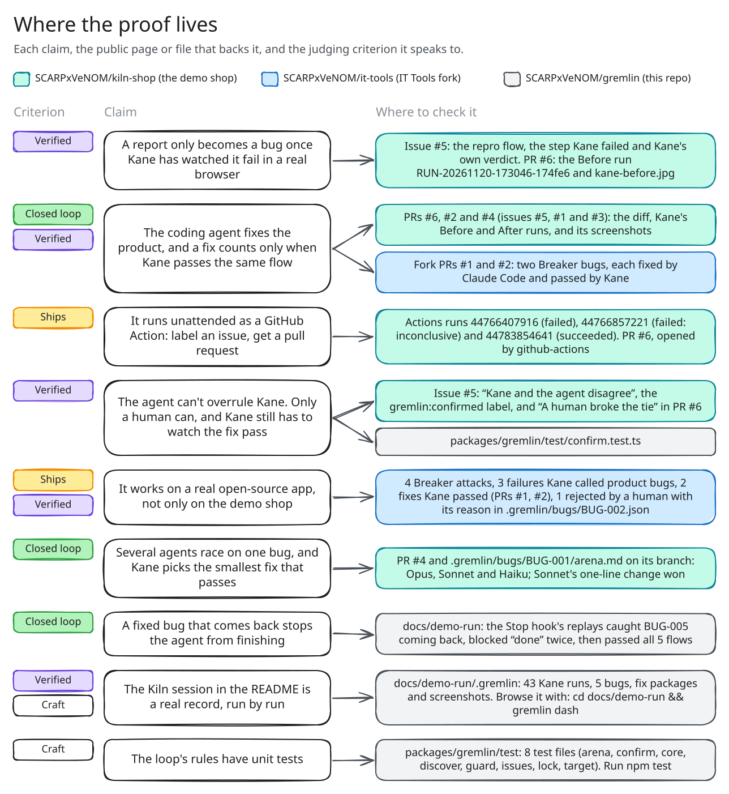
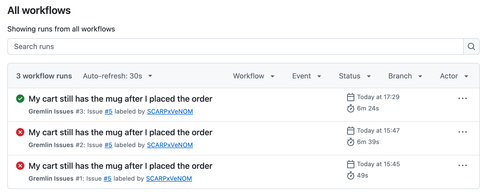
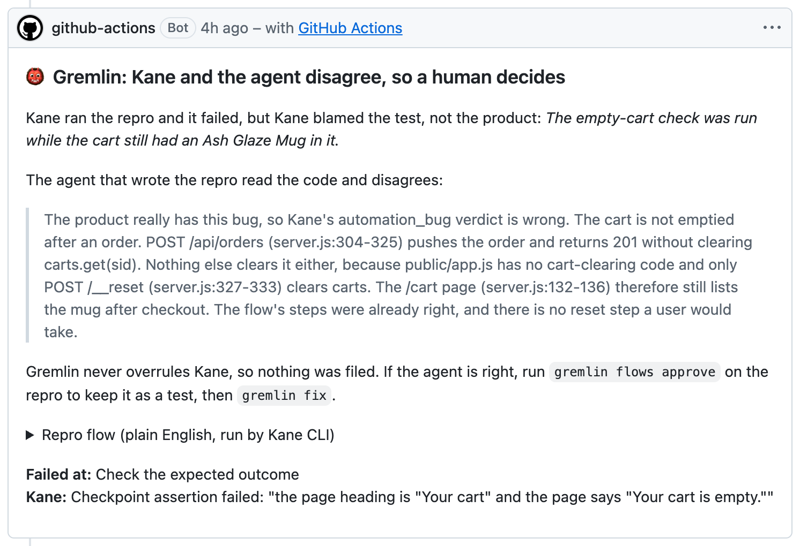

# It works: the evidence

Gremlin's claim is narrow: a bug report counts as a bug only once Kane CLI has watched it fail in a real browser, and
a fix counts only once Kane has watched the same flow pass. This page links every claim to something you can open
yourself: a GitHub issue, an Actions run, a pull request, a Kane run, or a file in this repo. Where something went
wrong, it says so (see [What didn't go to plan](#what-didnt-go-to-plan)).

All times are UTC. Unless a date is given, they are on 20 November 2026.

## Check it yourself in 2 minutes

1. **Open [kiln-shop PR #6](https://github.com/SCARPxVeNOM/kiln-shop/pull/6).** It was opened by `github-actions`, not
   by a person. Read the table of Kane runs, look at Kane's before and after screenshots, and open
   [Files changed](https://github.com/SCARPxVeNOM/kiln-shop/pull/6/files): the product fix is one line in `server.js`,
   and the rest is Gremlin's record of the bug, the locked regression flow and Kane's recording of it.
2. **Click Kane's run links in that table.** They open Kane's report on LambdaTest's test manager without an account.
   Both links open the same test case and show its latest version, which is the passing one. The failing run is
   recorded in steps 3 and 4 below and in Kane's before screenshot. (Gremlin now links only a run that saved the test,
   so pull requests opened from here on show the failing run by its ID and screenshot instead.)
3. **Read the [issue #5 thread](https://github.com/SCARPxVeNOM/kiln-shop/issues/5).** Five comments from
   `github-actions[bot]` and a trail of labels show each step: Kane failing the repro, Kane blaming the test, the agent
   disagreeing, a human adding `gremlin:confirmed`, and the fix.
4. **Open [Actions run 44783854641](https://github.com/SCARPxVeNOM/kiln-shop/actions/runs/44783854641/job/136453384490)**
   and expand *Reproduce, fix and prove issue*. Every Kane step, Kane's triage, Claude Code's edit and the re-run are in
   the log. GitHub asks you to sign in (any account) to read step logs.
5. **Browse the recorded Kiln session** without running anything:

   ```bash
   cd docs/demo-run && gremlin dash      # http://127.0.0.1:4777
   ```

## Every claim and where its proof is

| Claim | Evidence | Criterion |
| --- | --- | --- |
| A report only becomes a bug once Kane has watched it fail | [Issue #5](https://github.com/SCARPxVeNOM/kiln-shop/issues/5): [Kane's failing step and verdict](https://github.com/SCARPxVeNOM/kiln-shop/issues/5#issuecomment-7046276945). [PR #6](https://github.com/SCARPxVeNOM/kiln-shop/pull/6): the *Before* run `RUN-20261120-173046-174fe6` and [kane-before.jpg](https://github.com/SCARPxVeNOM/kiln-shop/blob/d2aa250a93729d63a9b7eeae0196fd1ef150d1e4/.gremlin/bugs/BUG-004/kane-before.jpg) | Verified |
| The coding agent fixes the product, and a fix counts only when Kane passes the same flow | kiln-shop [PR #6](https://github.com/SCARPxVeNOM/kiln-shop/pull/6), [PR #2](https://github.com/SCARPxVeNOM/kiln-shop/pull/2), [PR #4](https://github.com/SCARPxVeNOM/kiln-shop/pull/4). IT Tools fork [PR #1](https://github.com/SCARPxVeNOM/it-tools/pull/1), [PR #2](https://github.com/SCARPxVeNOM/it-tools/pull/2). Each shows the diff, Kane's before and after runs and its screenshots | Closed loop, Verified |
| It runs unattended as a GitHub Action: label an issue, get a pull request | Actions runs [44766407916](https://github.com/SCARPxVeNOM/kiln-shop/actions/runs/44766407916) (failed), [44766857221](https://github.com/SCARPxVeNOM/kiln-shop/actions/runs/44766857221) (failed, inconclusive), [44783854641](https://github.com/SCARPxVeNOM/kiln-shop/actions/runs/44783854641) (succeeded). [PR #6](https://github.com/SCARPxVeNOM/kiln-shop/pull/6) is authored by `app/github-actions` | Ships |
| The agent can't overrule Kane; only a human can, and Kane still has to watch the fix pass | [The dispute comment](https://github.com/SCARPxVeNOM/kiln-shop/issues/5#issuecomment-7044020173), the `gremlin:confirmed` label in the [issue #5 timeline](https://github.com/SCARPxVeNOM/kiln-shop/issues/5), "A human broke the tie" in [PR #6](https://github.com/SCARPxVeNOM/kiln-shop/pull/6), `confirmedBy` in [BUG-004.json](https://github.com/SCARPxVeNOM/kiln-shop/blob/d2aa250a93729d63a9b7eeae0196fd1ef150d1e4/.gremlin/bugs/BUG-004.json). Tests: [confirm.test.ts](../packages/gremlin/test/confirm.test.ts) | Verified |
| It works on a real open-source app, not only the demo shop | [SCARPxVeNOM/it-tools](https://github.com/SCARPxVeNOM/it-tools), a fork of [IT Tools](https://github.com/CorentinTh/it-tools): fork PRs [#1](https://github.com/SCARPxVeNOM/it-tools/pull/1) and [#2](https://github.com/SCARPxVeNOM/it-tools/pull/2), and one finding a human rejected, with the reason, in [BUG-002.json](https://github.com/SCARPxVeNOM/it-tools/blob/f127a8c3bf4a3e702964b91fa48523fa3452a419/.gremlin/bugs/BUG-002.json) | Ships, Verified |
| Several agents race on one bug and Kane picks the smallest fix that passes | [PR #4](https://github.com/SCARPxVeNOM/kiln-shop/pull/4) and its [arena.md](https://github.com/SCARPxVeNOM/kiln-shop/blob/ecf9c9f19e96472fd462cdb84c8f5ea85a6c2e14/.gremlin/bugs/BUG-001/arena.md) | Closed loop |
| A fixed bug that comes back stops the agent from finishing | [`docs/demo-run`](demo-run): the Stop hook's Guard runs in [events.jsonl](demo-run/.gremlin/events.jsonl) and [runs/](demo-run/.gremlin/runs) | Closed loop |
| The Kiln session in the README is a real record, run by run | [`docs/demo-run/.gremlin`](demo-run/.gremlin): 43 Kane runs, 5 bugs, fix packages, Kane's screenshots, the [credit ledger](demo-run/.gremlin/ledger.jsonl) | Verified, Craft |
| The loop's rules have unit tests | [`packages/gremlin/test`](../packages/gremlin/test), run with `npm test` | Craft |

The same map as a picture:

<p align="center">
  
</p>

## The live run: issue #5, from a label to a pull request

[Issue #5](https://github.com/SCARPxVeNOM/kiln-shop/issues/5) on the demo shop reports that the cart still holds the
mug after an order. Three runs of the Gremlin GitHub Action ran on it. Two failed, for different reasons, and the third
opened [PR #6](https://github.com/SCARPxVeNOM/kiln-shop/pull/6) with a fix Kane had watched pass.

<p align="center">
  <a href="diagrams/live-run.svg"></a>
</p>

<p align="center">
  
</p>

<sub>The kiln-shop Actions page, logged out, captured on 20 November 2026 ("Today"), clock set to UTC.</sub>

### Step by step

The times come from the [issue timeline API](https://api.github.com/repos/SCARPxVeNOM/kiln-shop/issues/5/timeline),
the run metadata and the step logs.

**Before the runs.** The repo owner added the issue workflow at 12:27:24
([2494c2f](https://github.com/SCARPxVeNOM/kiln-shop/commit/2494c2fb813391950d651552a2b80ed5c1a20301)) and opened
issue #5 at 12:27:32, written as a shopper's report. At 15:45:05 they added the `gremlin` label.

**Run 1, [44766407916](https://github.com/SCARPxVeNOM/kiln-shop/actions/runs/44766407916): failed in 49 s, before Kane
ran.** The workflow's `npm install` step rewrote `package-lock.json`. Gremlin opens a fix as a pull request from a clean
tree, so at 15:45:52 it stopped with *"Commit or stash your changes first (package-lock.json)"*. No Kane run, no
comment, nothing filed. At 15:47:34 the owner changed the workflow to `npm install --no-package-lock`
([8f21952](https://github.com/SCARPxVeNOM/kiln-shop/commit/8f2195207ee05351a2d8e661dea3a63656d1f394)) and put the
label back on at 15:47:43. Gremlin's own workflow generator writes that command now
([bdcbbe5](https://github.com/SCARPxVeNOM/gremlin/commit/bdcbbe513bcfe65cf101fec8017ea1eae3fe6e31)).

**Run 2, [44766857221](https://github.com/SCARPxVeNOM/kiln-shop/actions/runs/44766857221): failed as inconclusive.**

| Time | What happened |
| --- | --- |
| 15:47:48 | The run starts. At 15:48:31 Gremlin comments ["Gremlin is on it"](https://github.com/SCARPxVeNOM/kiln-shop/issues/5#issuecomment-7043889694) and adds `gremlin:working`. |
| 15:48:40 | Claude Code drafts a 6-step repro flow from the issue text. |
| 15:51:06 | Kane fails it at *Check the expected outcome* and fails it again on the automatic retry at 15:52:00. Kane's triage: `automation_bug`, 98% and 96%: *"The empty-cart check was run while the cart still had one Ash Glaze Mug."* |
| 15:52:17 | Because Kane blamed the test, Gremlin has the agent rewrite the flow once. The new last step says the order is paid for, so nothing in the cart should be touched. |
| 15:53:25 | Kane fails the rewritten flow at the same step, and again on the retry at 15:54:19. Still `automation_bug`, 96% and 98%. |
| 15:54:21 | The agent disagrees, citing `POST /api/orders (server.js:304-325)`, which saves the order and never clears the cart. Gremlin doesn't pick a side: it [posts both cases](https://github.com/SCARPxVeNOM/kiln-shop/issues/5#issuecomment-7044020173), adds `gremlin:needs-human` and files nothing. The run exits with code 1 at 15:54:27. |

<p align="center">
  
</p>

<sub>The comment from run 2, posted at 15:54:21. "4h ago" is relative to the capture.</sub>

**1 hour 35 minutes with nothing filed.** At 17:29:43 Gremlin gained the human tie-break
([3cf0d7f](https://github.com/SCARPxVeNOM/gremlin/commit/3cf0d7f7a4dfee4fc4f4b7042d29fe5b94c29f8d)), and at 17:29:45
the kiln-shop workflow started listening for the `gremlin:confirmed` label
([ab5327d](https://github.com/SCARPxVeNOM/kiln-shop/commit/ab5327d7b3c68c776324984b5df36b80914ddbf4)). At 17:29:54 the
owner sided with the agent and added `gremlin:confirmed`.

**Run 3, [44783854641](https://github.com/SCARPxVeNOM/kiln-shop/actions/runs/44783854641): succeeded.**

| Time | What happened |
| --- | --- |
| 17:29:58 | The run starts. At 17:30:44 Gremlin [comments](https://github.com/SCARPxVeNOM/kiln-shop/issues/5#issuecomment-7046191146) that the owner sided with the agent, so Kane runs the disputed repro again. It reuses the exact flow from Gremlin's own comment. |
| 17:30:46 | Kane run `RUN-20261120-173046-174fe6` fails at the same step at 17:33:21, and again on the retry at 17:34:25. Kane still blames the test, 98% both times. |
| 17:34:27 | Same step as the disputed run, so Gremlin files BUG-004 on SCARPxVeNOM's word and [comments the repro](https://github.com/SCARPxVeNOM/kiln-shop/issues/5#issuecomment-7046276945) with Kane's evidence. |
| 17:34:31 | Claude Code, attempt 1 of 3, gets the fix package. At 17:34:36 it edits `server.js`, adding `cartFor(sid).clear()` right after the order is saved. It finishes in 7.3 s. Gremlin restarts the shop so Kane tests the new code. |
| 17:34:39 | Kane run `RUN-20261120-173439-9ea924` re-runs the same flow. *Check the expected outcome* passes at 17:35:42 and the shop's price rule (a behaviour contract) passes at 17:36:05. It took 93.3 s and 18.64 credits, with 6 of its 8 steps replayed from Kane's earlier recording. |
| 17:36:15 | `app/github-actions` opens [PR #6](https://github.com/SCARPxVeNOM/kiln-shop/pull/6) and Gremlin [comments the result](https://github.com/SCARPxVeNOM/kiln-shop/issues/5#issuecomment-7046318401). The issue gets `gremlin:fix-proposed` at 17:36:18 and the run ends at 17:36:22. |

BUG-004 cost 106.91 Kane credits, from the failing repro to the passing fix
([BUG-004.json](https://github.com/SCARPxVeNOM/kiln-shop/blob/d2aa250a93729d63a9b7eeae0196fd1ef150d1e4/.gremlin/bugs/BUG-004.json)).

Kane's own screenshots of the last step, committed in PR #6:

| Before the fix (`RUN-20261120-173046-174fe6`) | After the fix (`RUN-20261120-173439-9ea924`) |
| --- | --- |
|  |  |

## IT Tools: a real open-source app

[IT Tools](https://github.com/CorentinTh/it-tools) is a popular open-source developer toolbox (about 41,000 GitHub
stars). Gremlin ran on a fork, [SCARPxVeNOM/it-tools](https://github.com/SCARPxVeNOM/it-tools), on a laptop, with
Claude Code as the agent and the app started by `npx vite --port 5199`. The Breaker sent Kane 4 attacks. One held
(the ETA calculator with its units box cleared). Three failed, and Kane judged each one a product bug:

| Bug | What Kane saw | Kane's confidence | Outcome |
| --- | --- | --- | --- |
| BUG-001 | JSON to CSV renders a nested object as `[object Object]` | 99% | Claude Code fixed it; Kane passed it. [Fork PR #1](https://github.com/SCARPxVeNOM/it-tools/pull/1) |
| BUG-002 | HTML entity unescape leaves `&copy;`, `&eacute;` and `&euro;` encoded | 98% | Rejected by a human (below) |
| BUG-003 | JSON to CSV shows nothing, and no error, for a single object | 94% | Claude Code fixed it; Kane passed it. [Fork PR #2](https://github.com/SCARPxVeNOM/it-tools/pull/2) |

- **PR #1** changes `json-to-csv.service.ts` to write objects and arrays as JSON, and adds a unit test. Kane failed the
  flow before the fix (`RUN-20261120-165257-fd08e6`) and passed it after (`RUN-20261120-170429-c49378`), plus one
  related flow. 58.15 Kane credits.
- **PR #2** treats a single object as a one-row array in `json-to-csv.vue` and shows an error for other non-arrays.
  Before: `RUN-20261120-165733-3950ea`. After: `RUN-20261120-172026-4a3ca5`, plus two related flows, one of them
  BUG-001's new regression flow. 60.24 Kane credits. It is stacked on PR #1, which isn't merged.
- **BUG-002 was rejected by a human**, who recorded why in
  [`.gremlin/bugs/BUG-002.json`](https://github.com/SCARPxVeNOM/it-tools/blob/f127a8c3bf4a3e702964b91fa48523fa3452a419/.gremlin/bugs/BUG-002.json):

  > By design: IT Tools describes this tool as escaping and unescaping only < > & " and ', so named entities like
  > &copy; are out of its scope. The attack expected more than the tool promises.

  The tool's own description agrees: *"Escape or unescape HTML entities (replace characters like <,>, &, " and ' with
  their HTML version)"*
  ([locales/en.yml](https://github.com/SCARPxVeNOM/it-tools/blob/f127a8c3bf4a3e702964b91fa48523fa3452a419/locales/en.yml#L226)).
  Kane was right that the output stayed encoded; the attack asked for more than the tool promises.

Nothing was posted to the upstream IT Tools repository. Both pull requests are on the fork.

| BUG-001 before the fix (`RUN-20261120-165257-fd08e6`) | After the fix (`RUN-20261120-170429-c49378`) |
| --- | --- |
|  |  |

## The agent arena: kiln-shop PR #4

[Issue #3](https://github.com/SCARPxVeNOM/kiln-shop/issues/3) reports that searching for "100% stoneware" shows an
error page. Gremlin ran on it from a laptop. Kane reproduced it (`RUN-20261120-163633-e0044c`), and three Claude Code
models fixed it at the same time, each in its own git worktree. Kane judged every fix in a real browser:

| Agent | Time | Change | Kane |
| --- | --- | --- | --- |
| Claude Code (Opus) | 17 s | +2 −2 in `server.js` | Failed, then passed on the retry: flaky, so it can't win |
| Claude Code (Sonnet) | 11 s | +1 −1 in `server.js` | Passed (`RUN-20261120-164114-90353a`), plus 1 related flow. **Winner** |
| Claude Code (Haiku) | 14 s | +2 −2 in `server.js` | Passed, but a larger change |

Sonnet's fix removed a second `decodeURIComponent` that threw on the bare `%`.
[PR #4](https://github.com/SCARPxVeNOM/kiln-shop/pull/4) carries the winning fix, Kane's before and after, and all
three patches with the
[arena record](https://github.com/SCARPxVeNOM/kiln-shop/blob/ecf9c9f19e96472fd462cdb84c8f5ea85a6c2e14/.gremlin/bugs/BUG-001/arena.md).
64.87 Kane credits.

[PR #2](https://github.com/SCARPxVeNOM/kiln-shop/pull/2) came the same way, from a laptop: issue #1, the lowercase
`welcome10` coupon, fixed by Claude Code and passed by Kane (`RUN-20261120-020943-3145f0`) with 2 related flows.
52.44 Kane credits.

## The recorded session: docs/demo-run

[`docs/demo-run`](demo-run) is Gremlin's `.gremlin/` folder from one session on [`examples/kiln`](../examples/kiln) on
18 November 2026, 10:59 to 12:12 UTC, with Claude Code as the agent. It holds every flow, all 43 Kane runs with their
step logs and screenshots, the 5 bugs, the fix packages Claude Code was given, the
[credit ledger](demo-run/.gremlin/ledger.jsonl) and the [event feed](demo-run/.gremlin/events.jsonl).

| Step | From the record | Kane runs | Credits |
| --- | --- | --- | --- |
| Replay | 3 happy flows, all passed | 3 | 5.66 |
| Breaker | 8 attacks: 4 bugs filed, 2 attacks folded into bugs already found, 1 held because Kane blamed the test, 1 passed | 10 | 539.51 |
| Capture | A complaint redacted and drafted into a repro; Kane failed it twice: BUG-005 | 1 | 47.32 |
| Fixer | BUG-005 and BUG-002 fixed on the first attempt, each with its related flows passing | 7 | 29.21 |
| Stop hook | Guard caught BUG-005 coming back at 11:53:38 and blocked Claude Code's "done" twice; at 12:03:14 all 5 flows passed | 15 | 39.15 |
| Final replay | 5 flows, all passing; BUG-005 marked fixed again | 5 | 0 |
| Stopped | A fix run and a manual run cancelled at 11:44 before they finished | 2 | 0 |

That is 43 runs and 660.85 credits; 25 of the runs cost nothing. BUG-002 and BUG-005 are fixed, and BUG-001, BUG-003
and BUG-004 are still open (status `candidate`). The regression Kane caught is
`RUN-20261118-172106-e2064a`; the replay that passed after Claude Code restored the fix is
`RUN-20261118-173221-01dddd`.

To browse it: `npm install -g gremlin-qa` (see the [Quickstart](../README.md#quickstart)), then `cd docs/demo-run && gremlin dash`.
It is a record, not a working project: the shop's code isn't in it.

## Unit tests

`npm test` runs the tests in [`packages/gremlin/test`](../packages/gremlin/test) with Node's test runner: 41 tests,
all passing on 21 November 2026, in about 12 seconds. They use stand-ins for Kane, the agent and `gh`, so they cost no
credits. The ones behind the claims on this page:

| File | What it checks |
| --- | --- |
| [confirm.test.ts](../packages/gremlin/test/confirm.test.ts) | A human's `gremlin:confirmed` re-runs the exact disputed repro and files it only if Kane fails it at the same step; only Gremlin's own comment is read back; the pull request names who broke the tie |
| [issues.test.ts](../packages/gremlin/test/issues.test.ts) | A proven fix becomes a pull request with Kane's before and after; uncommitted changes block the loop; a bug number held by an open branch is never reused |
| [arena.test.ts](../packages/gremlin/test/arena.test.ts) | Every agent gets the same bug, Kane judges each fix, and the smallest passing fix wins |
| [lock.test.ts](../packages/gremlin/test/lock.test.ts) | Each flow is locked in its own file and an edit is still caught |
| [guard.test.ts](../packages/gremlin/test/guard.test.ts) | A fix waiting in an open pull request isn't treated as a regression on main |

## What didn't go to plan

- **Two of the three Actions runs on issue #5 failed.** Run 1 never reached Kane because the workflow's `npm install`
  dirtied the tree. Run 2 ended inconclusive: Kane failed the repro four times (two flows, each with its retry) and
  blamed the test every time, so Gremlin filed nothing.
- **The human tie-break was built between run 2 and run 3.** Run 2's comment told the owner to settle it on their own
  machine (`gremlin flows approve`, then `gremlin fix`). The `gremlin:confirmed` path
  ([3cf0d7f](https://github.com/SCARPxVeNOM/gremlin/commit/3cf0d7f7a4dfee4fc4f4b7042d29fe5b94c29f8d)) and the workflow
  trigger ([ab5327d](https://github.com/SCARPxVeNOM/kiln-shop/commit/ab5327d7b3c68c776324984b5df36b80914ddbf4)) were
  committed 11 and 9 seconds before the owner added the label. Run 3 was the first run of that code.
- **Kane never changed its mind; only a human overruled it.** Kane blamed the test in all six failing attempts on
  issue #5 (96% to 98%), including the two in run 3. BUG-004 was filed on the owner's word, not the agent's, and the
  fix still had to pass Kane. The same bug had come up before: in the recorded Kiln session the Breaker hit it twice,
  Kane called both runs an automation fault, and Gremlin held it. Issue #1 had the same pattern: its first local run
  ended inconclusive, and the second one reproduced the bug.
- **On IT Tools a human overruled Kane the other way.** Kane called BUG-002 a product bug with 98% confidence; the
  human rejected it as out of the tool's scope.
- **No pull request has been merged.** kiln-shop PRs #2, #4 and #6 and fork PRs #1 and #2 are all open, and so are
  issues #1, #3 and #5. "Merging closes the issue" hasn't been exercised on them yet.
- **Only PR #6 came from CI.** kiln-shop PRs #2 and #4 and both fork PRs were opened from Gremlin running on a laptop,
  under SCARPxVeNOM's account. The kiln-shop workflow was added at 12:27:24, after PRs #2 and #4; the fork has no
  Actions runs.
- **Two PR descriptions were edited by hand after Gremlin opened them**, which GitHub shows as "edited". On PR #2,
  "claude-code" became "Claude Code" in two places. On PR #4, the line about Opus said "failed" and was changed to
  "flaky", with the explanation that its first Kane run landed on another app's page. Kane's summary of that run
  agrees: *"The check ran while the browser was still on an unrelated game start screen"*, and Gremlin's run record
  says flaky (failed, then passed on the retry). The committed arena.md still says "Kane failed it". Sonnet's fix won
  either way.
- **Kane's share links show the test case, not the run.** On PR #6 the *Before* and *After* links open the same Kane
  test case at its latest version, which passes. The failing run is in the issue thread, the Actions log and
  `kane-before.jpg`. Kane saves a new version of a test only when a run passes, so a failed run's link can never show
  the failure. Gremlin now links a run only if that run saved the version the link opens (`kaneShareLink` in
  [`kane.ts`](../packages/gremlin/src/core/kane.ts)); the pull requests above were opened before that change.
- **Run 2's Kane run IDs and credits aren't published.** Its step log shows each Kane step and verdict, and its
  evidence packs are in the run's `gremlin-issue-5` artifact (downloading it needs a GitHub sign-in), but no run IDs
  appear on GitHub.
- **The issue #5 report was written by the repo owner**, in a shopper's voice. The bug itself was not planted: the
  Breaker found it in the recorded session on 18 November (see the README's [Honest limits](../README.md#honest-limits)).
- **Kane run IDs use the clock of the machine that ran Kane.** On GitHub's runner that is UTC
  (`RUN-20261120-173046-…` started at 17:30:46 UTC). On the laptop it is India time, UTC+5:30, so PR #4's
  `RUN-20261120-163633-e0044c` ran at 11:06:33 UTC.
